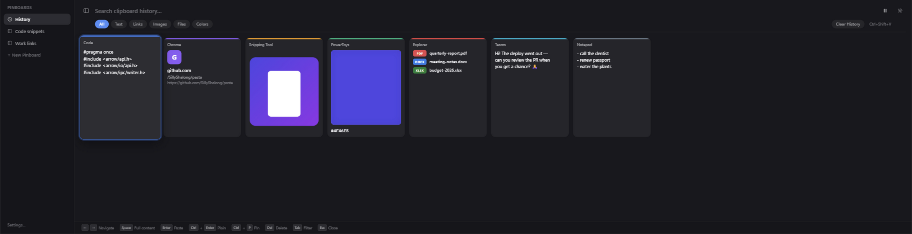
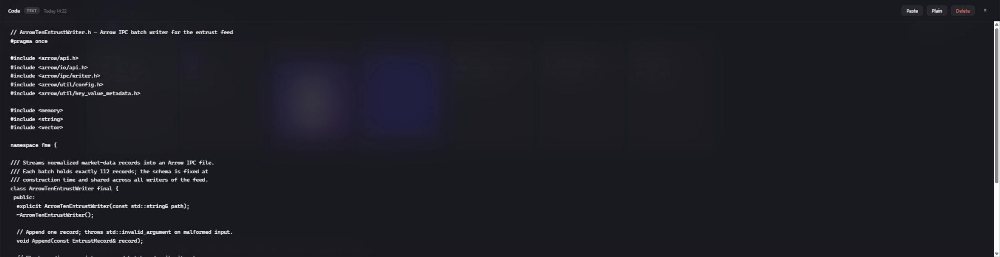

<div align="center">


# Paste for Windows

**A beautiful, keyboard-first clipboard manager — bringing the beloved
[Paste for macOS](https://pasteapp.io) experience to Windows.**

[](https://github.com/SillyShalong/paste/releases)
[](https://github.com/SillyShalong/paste/actions/workflows/build-release.yml)
[](https://github.com/SillyShalong/paste/releases)




*Everything you've ever copied — text, code, links, images, files, colors —
in one searchable strip, one keystroke away.*

</div>

---

## Why Paste for Windows?

Windows already gives you `Win+V`… and then forgets everything the moment you
reboot, buries your history in a tiny menu, and gives you zero organization.

Paste for Windows keeps **everything you copy, forever**, in a visual card
strip that spans your screen — each card tagged with the app it came from —
and lets you paste anything back with a single keystroke, in any app,
in the order you choose.

- 🎨 **Visual history** — every clip rendered as a rich card: syntax-highlighted
  code, link previews, image thumbnails, file lists, color swatches
- 🖥️ **Multi-monitor native** — the panel appears on the screen you're working on,
  positioned top / center / bottom, your choice
- ⌨️ **Keyboard-first** — navigate, preview, and paste without touching the mouse
- 📌 **Pinboards** — keep frequently used snippets permanently, organized into boards
- 🔍 **Power search** — full-text search across everything, plus per-type filters
- 🛡️ **Private by design** — data never leaves your machine; password managers are
  excluded from capture by default
- 🪶 **Lightweight** — a native Rust backend, ~2.4 MB installer, instant hotkey
  response

## 📥 Download

Grab the latest installer from
**[Releases](https://github.com/SillyShalong/paste/releases)** —
about 2.4 MB, no admin rights required (per-user install).

> **Requirements:** Windows 10 (1809+) or Windows 11. The WebView2 runtime is
> already part of Windows 11 and auto-installed on Windows 10.

## ✨ Features

### Unlimited, visual clipboard history

Everything you copy lands in a horizontal card strip — the newest on the left.
Each card is stamped with the **source app's icon and brand color**, so you can
see at a glance where a clip came from. Supported content: plain & rich text,
URLs, images, file lists, and hex colors.

### Multi-monitor & positional control

The panel follows you: it opens on the monitor of the window you were working
in, and snaps to the top, center, or bottom of that screen — configurable in
Settings.

### Full-content preview

<div align="center"></div>

Content too long for a card? Select it and press <kbd>Space</kbd> — a scrollable
full-content preview opens with the complete text, natural-size image, or full
file paths. Browse cards with `←`/`→` while the preview stays in sync.

### Pinboards

Copy a snippet you'll need again? Pin it. Boards live in the sidebar, survive
"clear history", and keep your color palettes, code snippets, and canned
responses one keystroke away.

### Tray icon to match your setup

<div align="center">

 &nbsp;
 &nbsp;
 &nbsp;
 &nbsp;
 &nbsp;


</div>

Six hand-tuned tray icons — pick the one that matches your theme in Settings.
Applied instantly, no restart needed.

### Privacy & control

- Everything is stored **locally** in SQLite — no cloud, no telemetry
- Per-app **exclusion list** (password managers like 1Password, Bitwarden,
  KeePass are skipped by default)
- One-click **pause** from the tray while screen-sharing
- Optional history size limit; pinned items survive clears

## ⌨️ Keyboard shortcuts

| Key | Action |
|-----|--------|
| `Ctrl+Shift+V` | Show / hide the panel *(remappable in settings)* |
| `←` / `→` | Navigate cards |
| `Space` | Full-content preview of the selected card |
| `Enter` | Paste the selected clip |
| `Ctrl+Enter` | Paste as plain text |
| `Ctrl+1` … `Ctrl+9` | Quick-paste the most recent clips — no panel needed |
| `Ctrl+P` | Pin / unpin the selected clip |
| `Del` | Delete the selected clip |
| `Tab` | Cycle type filters |
| `Ctrl+B` | Toggle the sidebar |
| `Esc` | Close |

Mouse users: hover a card for actions, **double-click** for the full-content
preview, **scroll wheel** scrolls the strip horizontally.

## 🗺️ Roadmap

- [x] Multi-monitor panel placement
- [x] Space full-content preview
- [x] Tray icon themes
- [ ] **macOS port (Apple Silicon)** — in active development on `dev`
- [ ] Paste Stack (queue multiple clips, paste in order)
- [ ] OCR search inside images
- [ ] Settings localization (中文 / 日本語)

## 🛠️ Development

```powershell
# prerequisites: Node.js LTS, Rust (stable-msvc), VS 2022 Build Tools (C++)
git clone https://github.com/SillyShalong/paste.git
cd paste
npm install
npm run tauri dev      # run with hot reload
npm run tauri build    # produce the NSIS installer
```

Stack: **Tauri 2** (Rust backend) + **React 18 / TypeScript** frontend + SQLite.
The clipboard pipeline is event-driven (no polling), paste restores focus via
`AttachThreadInput`, and all data lives in `%APPDATA%\com.pasteclone.app`.

See [`docs/`](docs/) for architecture notes and `src-tauri/examples/dbquery.rs`
for a small database inspection tool.

## 🙏 Acknowledgements

Designed with love as a Windows tribute to
[Paste for macOS](https://pasteapp.io) — the clipboard manager that set the bar.
If you're on a Mac, buy their subscription; if you're on Windows, welcome home. 💜
