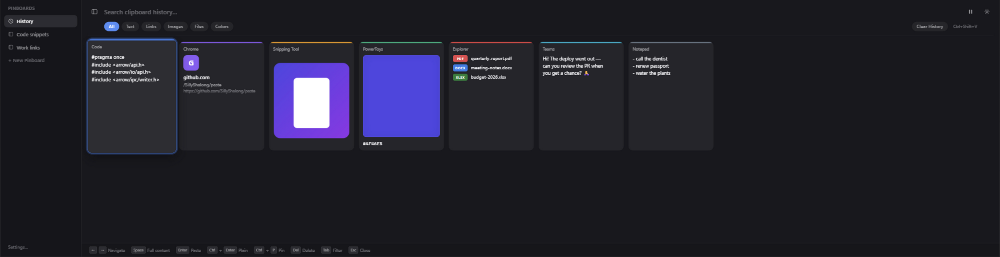

<div align="center">

[English](README.md) | 简体中文


# Paste

**一款支持 Windows 和 macOS、以键盘操作为主的可视化剪贴板管理器。**

[](https://github.com/SillyShalong/paste/releases)
[](https://github.com/SillyShalong/paste/actions/workflows/build-release.yml)
[](https://github.com/SillyShalong/paste/releases)




*你复制过的一切 —— 文本、代码、链接、图片、文件、颜色 ——
汇集在一条可搜索的卡片带里，一次按键即可取用。*

</div>

---

## 为什么选择 Paste？

Paste 让你在 Windows 和 macOS 上方便地浏览、搜索和整理剪贴板历史。

Paste **保留你复制过的一切**：一条横贯屏幕的可视化卡片带 —— 每张卡片都标注了
内容来自哪个应用 —— 让你按一次键，就能以任意顺序把任何内容粘贴回任何应用。

- 🎨 **可视化历史** —— 每条记录都是一张富卡片：语法高亮代码、链接预览、图片
  缩略图、文件列表（图片文件直接显示图片本身）、色块
- 🖥️ **原生多显示器** —— 面板出现在你正在工作的屏幕上，可置于顶部 / 中部 / 底部
- ⌨️ **键盘优先** —— 导航、预览、粘贴，全程无需鼠标
- 🌏 **English / 简体中文** —— 界面语言跟随系统，或在设置中固定
- 📌 **收藏板（Pinboards）** —— 把常用片段永久保存，分门别类放进侧栏
- 🔍 **强力搜索** —— 全文检索所有历史，外加按类型筛选
- 🛡️ **隐私至上** —— 数据永不离机；密码管理器默认排除采集；双平台均有单实例保护
- 🪶 **轻量** —— 原生 Rust 后端，Windows 安装包约 2.5 MB，快捷键响应即时

## 📥 下载

### Windows

[Releases](https://github.com/SillyShalong/paste/releases) 页面提供两种形式：

- **安装版**（`Paste_x.y.z_x64-setup.exe`，约 2.5 MB）—— 按用户安装，
  带开始菜单快捷方式与卸载器，无需管理员权限。
- **便携版**（`Paste_x.y.z_x64-portable.zip`，约 3 MB）—— 解压后直接运行
  `Paste.exe`，不做任何安装；适合 U 盘和无法运行安装器的机器。

> **系统要求：** Windows 10 (1809+) 或 Windows 11。WebView2 运行时已内置于
> Windows 11，Windows 10 会自动安装。

### macOS（Apple Silicon）

从 [Releases](https://github.com/SillyShalong/paste/releases) 页面下载 Apple Silicon
版本的 `.dmg` 或应用压缩包，也可以在 M 系列 Mac 上从源码构建（见[开发](#️-开发)）。
CI 还提供 `Paste-macos-aarch64` 构建产物。

> **系统要求：** macOS 11+ 且为 Apple Silicon。粘贴到其他应用需要
> **辅助功能**权限（系统设置 → 隐私与安全性 → 辅助功能 → 添加 Paste）；
> 授权前设置页会显示提示横幅。得益于基于标识符的签名，授权在应用更新后
> 依然有效。
>
> **首次运行下载的副本：** 应用采用 ad-hoc 签名（无 Apple 开发者账号，
> 无法公证），macOS 可能提示 "Paste.app is damaged and can't be opened"。
> 应用并未损坏——这只是下载隔离标记。清除一次即可正常打开：
> `xattr -cr /Applications/Paste.app`

## ✨ 功能

### 无限的可视化剪贴板历史

复制的一切都会进入横向卡片带 —— 最新的在最左侧。每张卡片都带有
**来源应用的图标和品牌色**，一眼就能看出内容来自哪里。支持的内容：纯文本与
富文本、URL、图片、文件列表、十六进制颜色。复制图片*文件*时，卡片直接显示
图片本身，而不是路径。

### 多显示器与位置控制

面板跟着你走：在你刚才工作的屏幕上弹出，并可吸附到该屏幕的顶部、中部或
底部（默认）—— 都可以在设置中调整。

### 全文预览

内容太长放不进卡片？选中后按 <kbd>Space</kbd> —— 会打开一个可滚动的全文
预览：完整文本、原始尺寸图片、图片文件背后的图片，或完整文件路径。预览打开时
可用 `←`/`→` 浏览卡片，预览内容保持同步。

### 毛玻璃面板

面板以半透明条带悬浮于桌面之上 —— macOS 使用原生窗口材质
（NSVisualEffectView，第一帧即清晰呈现），Windows 使用 CSS 背景模糊。

### 收藏板

有会反复使用的内容？固定它。收藏板位于侧栏，"清空历史"也不会丢，
让你的调色板、代码片段、常用话术一键可达。

### 与桌面搭配的托盘图标

<div align="center">

 &nbsp;
 &nbsp;
 &nbsp;
 &nbsp;
 &nbsp;


</div>

六款精心设计的托盘图标 —— 在设置中选择与你的主题匹配的一款，
即时生效，无需重启。

### 隐私与控制

- 所有数据**本地**存储于 SQLite —— 无云端、无遥测
- 按应用的**排除名单**（1Password、Bitwarden、KeePass 等密码管理器默认排除 ——
  同时覆盖 Windows 与 macOS 的可执行文件名）
- 共享屏幕时可从托盘一键**暂停**记录
- 可选历史条数上限；置顶项在清空时保留
- 可选自动删除：未置顶历史默认永久保留，也可按 5/10/30 天、3 个月或
  自定义天数自动清理——置顶项与设置不受策略切换影响
- 单实例保护：重复启动第二个实例会立即退出

## ⌨️ 键盘快捷键

Windows 上为 `Ctrl`，macOS 上为 `Cmd` —— 相同的按键，相同的操作。

| 按键 | 操作 |
|-----|--------|
| `Ctrl/Cmd+Shift+V` | 显示 / 隐藏面板 *（可在设置中自定义）* |
| `←` / `→` | 在卡片间导航 |
| `Space` | 查看选中卡片的全文预览 |
| `Enter` | 粘贴选中的内容 |
| `Ctrl/Cmd+Enter` | 以纯文本粘贴 |
| `Ctrl/Cmd+1` … `Ctrl/Cmd+9` | 快速粘贴最近的内容 —— 无需打开面板 |
| `Ctrl/Cmd+P` | 置顶 / 取消置顶选中的内容 |
| `Del` | 删除选中的内容 |
| `Tab` | 切换类型筛选 |
| `Ctrl/Cmd+B` | 收起 / 展开侧栏 |
| `Esc` / 点击面板外 | 关闭 |

鼠标用户：悬停卡片查看操作，**双击**打开全文预览，**滚轮**横向滚动卡片带
（方向可配置）。

## 🍎 macOS 实现说明

分平台实现：

```
src-tauri/src/
  macos.rs               hand-rolled msg_send bindings: NSPasteboard read/write,
                         NSWorkspace frontmost app + icon, NSRunningApplication
                         activation, CGEvent Cmd+V synthesis (events carry the
                         Command flag — bare keycodes don't), AX permission check
  clipboard/listener.rs  Windows: message-only window (event-driven);
                         macOS: NSPasteboard.changeCount polling (thread-safe)
  clipboard/capture.rs   Windows: CF_* flavors; macOS: UTI flavors via NSPasteboard
  clipboard/set.rs       writes any clip kind back (Win32 / NSPasteboard)
  appinfo.rs             foreground app → icon → brand color (Win32 / NSWorkspace)
  paste.rs               focus restore (AttachThreadInput / activateWithOptions:)
                         + keystroke synthesis (SendInput Ctrl+V / CGEvent Cmd+V)
```

设计说明：

- **不使用私有剪贴板 API。** 采集通过专用线程轮询 `NSPasteboard.changeCount`
  （150 毫秒）；`NSPasteboard` 是官方文档明确的线程安全接口。
  （`macOSPrivateApi` 仅用于窗口/WebView 透明。）
- **主线程纪律。** `NSWorkspace`/`NSImage` 调用通过 `state::on_main_sync`
  派发到主线程（已在主线程时内联执行，不会死锁）。
- **辅助功能权限** 是合成 Cmd+V 的前提。应用启动时会输出
  `accessibility_trusted` 日志，授权前设置页会显示横幅。
- **稳定签名。** 构建产物会以基于 bundle 标识符的要求重签
  （`scripts/codesign-stable.sh`），因此辅助功能授权在重新构建与更新后依然
  有效 —— 单纯的 ad-hoc 签名会让授权失效。
- **单实例** 通过应用支持目录中锁文件的 `flock(2)` 实现。
- 快捷键遵循平台惯例：默认快捷键映射为 `Cmd+Shift+V`；快速粘贴注册
  `Cmd+1…9` 而非 `Ctrl+1…9`。
- 前端两端共享；`Ctrl`/`Cmd` 标签通过 `src/lib/platform.ts` 切换。

## 🛠️ 开发

**Windows** —— 前置要求：Node.js LTS、Rust (stable-msvc)、VS 2022 Build Tools
(C++)：

```powershell
git clone https://github.com/SillyShalong/paste.git
cd paste
npm install
npm run tauri dev      # 热重载运行
npm run tauri build    # NSIS 安装包 + 便携版 zip
```

**macOS（Apple Silicon）** —— 前置要求：Node.js LTS、rustup 安装的 Rust：

```bash
git clone https://github.com/SillyShalong/paste.git
cd paste
npm install
npm run tauri dev                                  # 热重载运行
npm run tauri build -- --target aarch64-apple-darwin --bundles app
./scripts/codesign-stable.sh                       # 保持辅助功能授权稳定
# → Paste.app 位于 src-tauri/target/aarch64-apple-darwin/release/bundle/macos/
```

设计变更后从 SVG 源重新生成应用与托盘图标：

```bash
node scripts/gen-icons.mjs                           # 生成 app-icon.png + 托盘图标组
npx tauri icon src-tauri/icons/app-icon.png          # 平台图标集 (icns/ico/pngs)
```

技术栈：**Tauri 2**（Rust 后端）+ **React 18 / TypeScript** 前端 + SQLite。
提交修改前，请在受支持的 Windows 或 macOS 开发环境运行 `npm test`、
`npm run typecheck` 和 `cargo test --locked --manifest-path src-tauri/Cargo.toml`。
CI 会在构建前执行这些检查。
Windows 剪贴板管线为事件驱动（无轮询）；macOS 轮询
`NSPasteboard.changeCount`。粘贴时会把焦点还给之前的应用
（`AttachThreadInput` / `activateWithOptions:`），数据位于
`%APPDATA%\com.pasteclone.app`（Windows）或
`~/Library/Application Support/com.pasteclone.app`（macOS）。

架构说明见 [`docs/`](docs/)，数据库检查工具见
`src-tauri/examples/dbquery.rs`，macOS AppKit 绑定的独立探针见
`src-tauri/examples/frontmost.rs`。

## 🗺️ 路线图

- [x] 多显示器面板定位
- [x] Space 全文预览
- [x] 托盘图标主题
- [x] **macOS 支持（Apple Silicon）**
- [x] 设置界面本地化（English / 简体中文）
- [ ] Paste Stack（多条内容排队，按序粘贴）
- [ ] 图片内容 OCR 搜索
